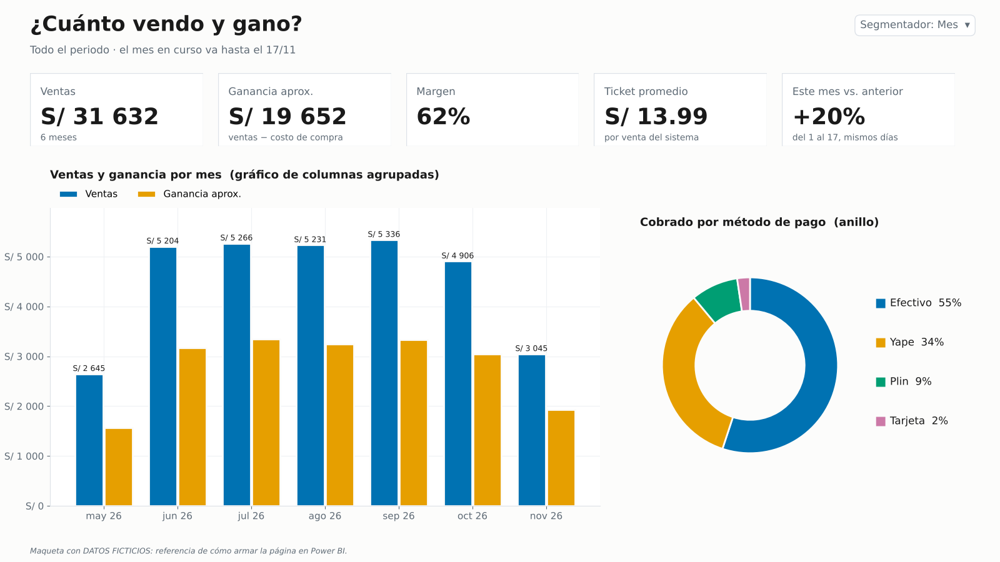
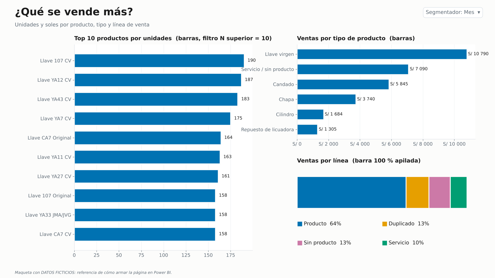
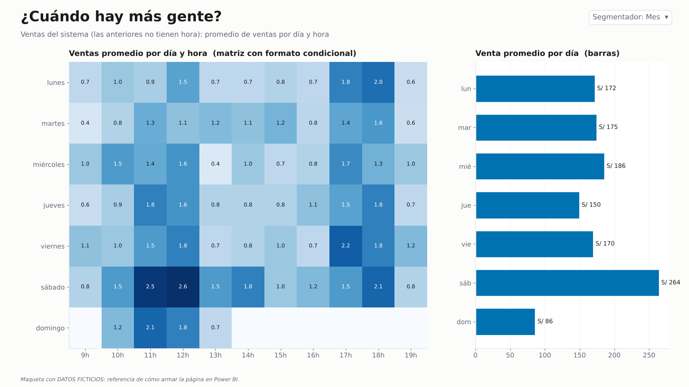
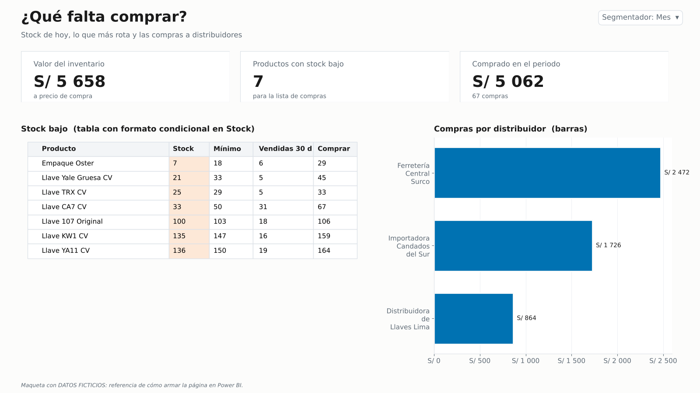

# Tablero en Power BI, paso a paso

Cuatro páginas, una por pregunta: **¿Cuánto vendo y gano?**, **¿Qué se vende más?**, **¿Cuándo hay más gente?** y **¿Qué falta comprar?** En [`powerbi/maquetas/`](powerbi/maquetas/) está cómo debe quedar cada una, hecha con datos ficticios. Los menús están en español (Power BI Desktop en español). Se arma en una hora, más o menos.

Archivos que se usan:
- `cerrajeria-datos.xlsx`: el que descarga el sistema (**Reportes → Descargar Excel**, solo Administrador). Para practicar sirve `cerrajeria-datos-FICTICIOS.xlsx`, que tiene las mismas hojas y columnas.
- [`powerbi/tema-cerrajeria.json`](powerbi/tema-cerrajeria.json): colores que se distinguen con daltonismo y letra más grande.

> **Guarda el Excel siempre en la misma carpeta y con el mismo nombre.** Para actualizar el tablero solo se reemplaza el archivo y se pulsa **Actualizar**. Para pasar de los datos ficticios a los reales, cambia el valor del parámetro `RutaExcel` (paso 1).

---

## Paso 0 — Antes de cargar nada (1 minuto)

**Archivo → Opciones y configuración → Opciones → Archivo actual → Carga de datos**: desmarca **Detectar automáticamente nuevas relaciones después de cargar los datos**. Si no, Power BI une solas hojas que no deben unirse (por ejemplo, Ventas con Kárdex por el código) y los números salen mal.

Aplica el tema: **Vista → Temas → Examinar temas** → `tema-cerrajeria.json`.

## Paso 1 — Cargar el Excel (con los tipos fijos)

Si dejas que Power BI adivine los tipos, se equivoca con las hojas que todavía no tienen datos: **Taller** sin órdenes sale como `Column1, Column2…`, y `Cierre` de una caja abierta sale como texto. Por eso las consultas de [`powerbi/consultas-power-query.m`](powerbi/consultas-power-query.m) dicen el tipo de cada columna, y así funcionan igual con hojas vacías y cuando después lleguen datos.

**A. Crear el parámetro con la ruta del Excel**
1. **Inicio → Transformar datos** (se abre Power Query).
2. **Inicio → Administrar parámetros → Nuevo parámetro**.
3. Nombre: `RutaExcel`. Tipo: **Texto**. Valor actual: la ruta completa del archivo, por ejemplo `C:\Users\TuNombre\Documents\cerrajeria-datos.xlsx` (en el Explorador: clic derecho en el archivo → **Copiar como ruta de acceso**; quita las comillas).

Para pasar de los datos ficticios a los reales, solo cambias el valor de este parámetro.

**B. Crear las 9 consultas**
Si ya habías cargado hojas con **Obtener datos**, bórralas (clic derecho → Eliminar). Luego, para **cada una de las 9 hojas** (Ventas, Cobros, Taller, Domicilio, Productos, Kardex, Compras, Cajas, MovimientosCaja):
1. **Inicio → Nuevo origen → Consulta en blanco**.
2. **Inicio → Editor avanzado**: borra todo y pega el bloque de esa hoja de `consultas-power-query.m` (desde `let` hasta `Tipos`).
3. **Listo**, y cambia el nombre de la consulta a la hoja (`Ventas`, `Taller`…), con exactamente ese nombre: las relaciones y las medidas lo usan.

Si algo sale con error, mira el paso que falló: lo más común es que `RutaExcel` tenga comillas o una letra mal puesta.

## Paso 2 — Cerrar y aplicar

Con esas consultas **no hace falta convertir las fechas a mano**: ya vienen como Fecha, Fecha y hora o Número. Revisa que las columnas `Fecha` muestren el ícono de calendario, y pulsa **Inicio → Cerrar y aplicar**. Si te pide permiso para leer el archivo, elige **Archivo** y **Usar credenciales actuales / Conectar**.

## Paso 3 — Tabla de calendario

**Modelado → Nueva tabla** y pega:

```DAX
Calendario =
VAR Inicio = MIN ( Ventas[Fecha] )
VAR Fin = MAX ( Ventas[Fecha] )
RETURN
    ADDCOLUMNS (
        CALENDAR ( Inicio, Fin ),
        "Año", YEAR ( [Date] ),
        "Mes", FORMAT ( [Date], "mmm yyyy" ),
        "MesNumero", YEAR ( [Date] ) * 100 + MONTH ( [Date] ),
        "Día de la semana", FORMAT ( [Date], "dddd" ),
        "DíaNumero", WEEKDAY ( [Date], 2 )
    )
```

Después:
- En la vista de **Datos**, selecciona la columna `Mes` → **Herramientas de columna → Ordenar por columna → MesNumero**. Igual con `Día de la semana` → **DíaNumero**. Si no, los meses salen en orden alfabético.
- **Herramientas de tabla → Marcar como tabla de fechas** → columna `Date`.

> Si alguna fórmula da error de sintaxis, tu Power BI usa `;` en vez de `,` entre argumentos. Cámbialo en **Archivo → Opciones → Configuración regional → Separadores de DAX**, o reemplaza `,` por `;` en las fórmulas.

## Paso 4 — Relaciones (vista de modelo)

Abre la **Vista de modelo** (ícono de las tres cajitas, a la izquierda). Arrastra de la columna de la izquierda a la de la derecha. Todas son **de uno a varios (1:*)**, con dirección de filtro **Única**:

| Desde | Hacia |
|---|---|
| `Calendario[Date]` | `Ventas[Fecha]` |
| `Calendario[Date]` | `Cobros[Fecha]` |
| `Calendario[Date]` | `Compras[Fecha]` |
| `Calendario[Date]` | `Kardex[Fecha]` |
| `Calendario[Date]` | `Cajas[Fecha]` |
| `Calendario[Date]` | `Domicilio[Fecha]` |
| `Calendario[Date]` | `MovimientosCaja[Fecha]` |
| `Calendario[Date]` | `Taller[Fecha ingreso]` |
| `Productos[Código]` | `Ventas[Código]` |
| `Productos[Código]` | `Compras[Código]` |
| `Productos[Código]` | `Kardex[Código]` |

Si ves otras líneas que no están en la tabla, clic derecho → **Eliminar**.

## Paso 5 — Medidas

En el panel **Datos**, clic derecho en la tabla indicada → **Nueva medida**, y pega una por una. Al terminar cada una, dale formato en **Herramientas de medición → Formato**: **Moneda** con `S/ Español (Perú)` y 2 decimales para los soles, y **Porcentaje** para los `%`.

**En la tabla Ventas:**

```DAX
Ventas S/ = CALCULATE ( SUM ( Ventas[Subtotal] ), Ventas[Anulada] = "No" )
```
```DAX
Unidades = CALCULATE ( SUM ( Ventas[Cantidad] ), Ventas[Anulada] = "No" )
```
```DAX
Costo S/ =
CALCULATE (
    SUMX ( Ventas, Ventas[Cantidad] * Ventas[Costo unitario] ),
    Ventas[Anulada] = "No"
)
```
```DAX
Ganancia aprox. S/ = [Ventas S/] - [Costo S/]
```
```DAX
Margen % = DIVIDE ( [Ganancia aprox. S/], [Ventas S/] )
```
```DAX
Tickets = CALCULATE ( DISTINCTCOUNT ( Ventas[Venta] ), Ventas[Origen] = "Sistema", Ventas[Anulada] = "No" )
```
```DAX
Ticket promedio = DIVIDE ( CALCULATE ( [Ventas S/], Ventas[Origen] = "Sistema" ), [Tickets] )
```
```DAX
Ventas del mes a la fecha = CALCULATE ( [Ventas S/], DATESMTD ( Calendario[Date] ) )
```
```DAX
Ventas mismos días mes anterior =
CALCULATE ( [Ventas S/], DATEADD ( DATESMTD ( Calendario[Date] ), -1, MONTH ) )
```
```DAX
Este mes vs. anterior =
DIVIDE (
    [Ventas del mes a la fecha] - [Ventas mismos días mes anterior],
    [Ventas mismos días mes anterior]
)
```
```DAX
Venta promedio por día = AVERAGEX ( VALUES ( Calendario[Date] ), [Ventas S/] + 0 )
```
```DAX
Días con ventas del sistema =
CALCULATE ( DISTINCTCOUNT ( Ventas[Fecha] ), Ventas[Origen] = "Sistema", ALL ( Ventas[Hora] ) )
```
```DAX
Ventas promedio por hora = DIVIDE ( [Tickets], [Días con ventas del sistema] )
```
```DAX
Unidades últimos 30 días =
CALCULATE ( [Unidades], DATESINPERIOD ( Calendario[Date], MAX ( Calendario[Date] ), -30, DAY ) )
```

**En la tabla Cobros:**

```DAX
Cobrado S/ = CALCULATE ( SUM ( Cobros[Monto] ), Cobros[Anulada] = "No" )
```

**En la tabla Productos:**

```DAX
Valor del inventario = SUM ( Productos[Valor del stock] )
```
```DAX
Productos con stock bajo =
CALCULATE ( COUNTROWS ( Productos ), Productos[Stock bajo] = "Sí", Productos[Activo] = "Sí" )
```

Y una **columna** (no medida): en la tabla Productos, **Herramientas de tabla → Nueva columna**:

```DAX
Sugerido comprar = MAX ( 0, 2 * Productos[Stock mínimo] - Productos[Stock] )
```

(Lo que falta para llegar al doble del mínimo, igual que la lista de compras de la app.)

**En la tabla Compras:**

```DAX
Comprado S/ = SUM ( Compras[Total] )
```

Por qué algunas son así:
- **Este mes vs. anterior** compara los **mismos días**: del 1 al día de hoy de este mes contra el 1 al mismo día del mes pasado. Comparar un mes a medias contra uno completo siempre daría que se vende menos.
- **Venta promedio por día** suma `+ 0` para que los días sin ventas cuenten como cero, y no se salten.
- **Ventas promedio por hora** usa solo las ventas del **sistema**: las anteriores (del cuaderno) no tienen hora.
- **Ganancia aprox.** usa el precio de compra **de hoy** de cada producto, no el que tenía el día de la venta. Los servicios no tienen costo, así que cuentan completos como ganancia.

## Paso 6 — Las cuatro páginas

En todas las páginas: arriba a la izquierda un **Cuadro de texto** con la pregunta como título, y arriba a la derecha una **Segmentación de datos** con `Calendario[Mes]`, con estilo **Lista desplegable** (en el panel de formato, Configuración de segmentación → Opciones → Estilo). Para que el mes elegido valga en todas las páginas: **Vista → Sincronizar segmentaciones** y marca las cuatro.

Renombra cada página con doble clic en su pestaña de abajo.

### Página 1 — ¿Cuánto vendo y gano?



1. **Cinco tarjetas** en fila (visual **Tarjeta**), una por medida: `Ventas S/`, `Ganancia aprox. S/`, `Margen %`, `Ticket promedio`, `Este mes vs. anterior`.
2. **Gráfico de columnas agrupadas**: Eje X = `Calendario[Mes]`; Eje Y = `Ventas S/` y `Ganancia aprox. S/`. En formato, activa **Etiquetas de datos**.
3. **Gráfico de anillos**: Leyenda = `Cobros[Método de pago]`; Valores = `Cobrado S/`. En formato → Etiquetas de detalle → **Categoría, porcentaje del total**.

### Página 2 — ¿Qué se vende más?



1. **Gráfico de barras agrupadas** (el grande, a la izquierda): Eje Y = `Ventas[Producto]`; Eje X = `Unidades`. En el panel **Filtros** → `Producto` → Tipo de filtro **N superior** → Mostrar elementos **Superior 10** → Por valor: arrastra `Unidades` → **Aplicar filtro**. Activa las etiquetas de datos.
2. **Gráfico de barras agrupadas**: Eje Y = `Ventas[Tipo]`; Eje X = `Ventas S/`. Las filas sin tipo son servicios y ventas anteriores que no coincidieron con un producto.
3. **Gráfico de barras 100% apiladas**: Leyenda = `Ventas[Línea]`; Eje X = `Ventas S/`. Muestra cuánto es duplicado, producto, servicio o "sin producto".
4. Opcional: una **Tabla** con `Ventas[Producto]`, `Unidades`, `Ventas S/` y `Ganancia aprox. S/`, ordenada por Ventas S/.

> Ojo: en las ventas **anteriores** el duplicado no se distingue de la llave sola (salen como "Producto"). La comparación de duplicados vale desde que se usa el sistema.

### Página 3 — ¿Cuándo hay más gente?



1. **Matriz**: Filas = `Calendario[Día de la semana]`; Columnas = `Ventas[Hora]`; Valores = `Ventas promedio por hora`. Después:
   - En el panel **Filtros** de este visual: `Ventas[Origen]` = **Sistema**.
   - Clic derecho en `Ventas promedio por hora` (en Valores) → **Formato condicional → Color de fondo** → Estilo **Escala de colores**, de blanco a azul oscuro.
   - En formato → **Valores**: 1 decimal. Así se ve de un vistazo qué días y horas se llena el local.
2. **Gráfico de barras agrupadas**: Eje Y = `Calendario[Día de la semana]`; Eje X = `Venta promedio por día`. Ordénalo por `Día de la semana`: en los tres puntos del visual → **Ordenar eje**.

### Página 4 — ¿Qué falta comprar?



1. **Tres tarjetas**: `Valor del inventario`, `Productos con stock bajo`, `Comprado S/`.
2. **Tabla** con `Productos[Producto]`, `Productos[Stock]`, `Productos[Stock mínimo]`, `Unidades últimos 30 días` y `Productos[Sugerido comprar]`:
   - Filtros de este visual: `Productos[Stock bajo]` = **Sí** y `Productos[Activo]` = **Sí**.
   - Clic derecho en `Stock` → **Formato condicional → Color de fondo**, en tono naranja claro, para que salte a la vista.
   - Ordena por `Stock` de menor a mayor: así es la lista de compras del día.
3. **Gráfico de barras agrupadas**: Eje Y = `Compras[Distribuidor]`; Eje X = `Comprado S/`.

> El stock y el valor del inventario son **los de hoy**: el mes elegido arriba no los cambia. Sí cambia lo comprado y las unidades vendidas.

## Paso 7 — Guardar y actualizar

- **Archivo → Guardar como** → `Tablero cerrajería.pbix`, en la misma carpeta que el Excel.
- Cada vez que quieras ver datos nuevos:
  1. En el sistema, **Reportes → Descargar Excel** (elige desde la primera fecha hasta hoy).
  2. Guárdalo encima del anterior, con el mismo nombre y carpeta.
  3. En Power BI, **Inicio → Actualizar**.

---

## Referencia: qué trae cada hoja

| Hoja | Una fila por… | Columnas clave |
|---|---|---|
| **Ventas** | línea vendida (y cada venta anterior cargada) | Fecha, Hora (0–23), Origen (`Sistema`/`Anterior`), Código, Producto, Tipo, Línea (`Duplicado`/`Producto`/`Servicio`/`Sin producto`), Cantidad, Subtotal, Costo unitario, Método de pago, Anulada |
| **Cobros** | pago recibido (una venta mixta, en varias filas) | Fecha, Origen (`Venta`/`Taller`/`Domicilio`), Método de pago, Monto (negativo = devolución), Anulada |
| **Taller** | orden de trabajo | Fecha ingreso/entrega, Estado, Precio total, Pagado, Saldo, Garantía, Días en el taller |
| **Domicilio** | servicio a domicilio | Fecha, Hora, Servicio, Estado, Cobrado, Técnico |
| **Productos** | producto (catálogo de hoy) | Código, Tipo, Stock, Stock mínimo, Stock bajo, Precio compra/venta, Valor del stock, Activo |
| **Kardex** | movimiento de stock | Fecha, Código, Movimiento, Cantidad, Saldo anterior/nuevo, Por, Motivo |
| **Compras** | compra a un distribuidor | Fecha, Distribuidor, Código, Cantidad, Total, Pagado de caja |
| **Cajas** | caja abierta | Fecha, Usuario, Ingresos, Egresos, Yape, Plin, Tarjeta, Efectivo contado, Diferencia |
| **MovimientosCaja** | ingreso o egreso puesto a mano | Fecha, Tipo, Monto (negativo = egreso), Motivo |

Las **ventas anteriores** se suben en **Reportes → Ventas de antes del sistema** (CSV con `fecha`, `producto`, `cantidad` y `precio` o `total`; `codigo` y `metodo_pago` opcionales). No tocan la caja ni el stock.
